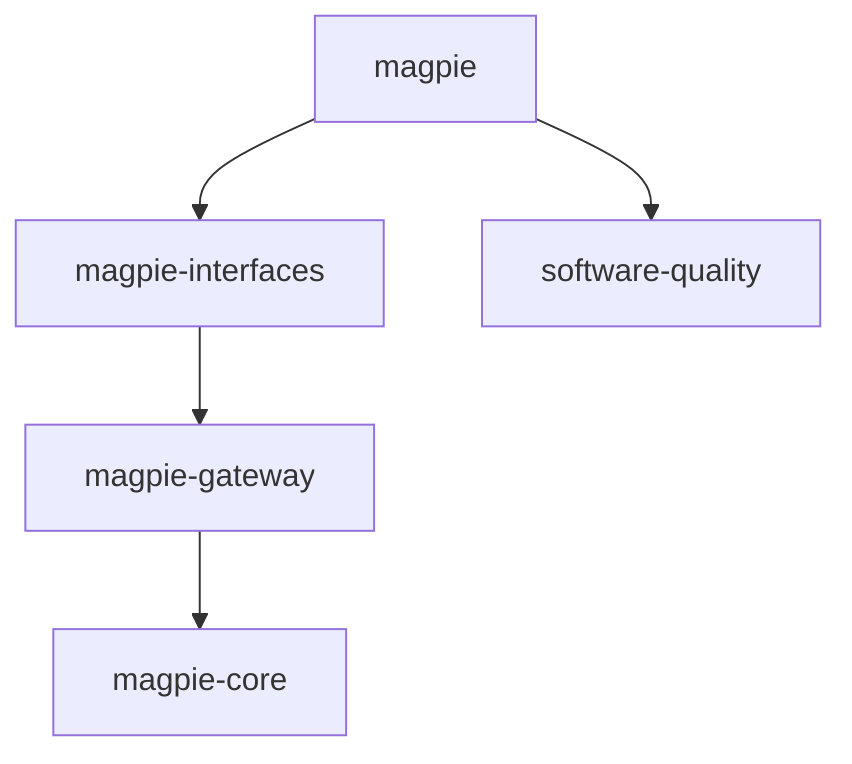

# 依赖及运行前提

四个 magpie 节点是产品软件重建配方，software-quality 是跨组件设计/代码/性能合同；所有 source 都是有效的同仓配方目录。core 和 quality 没有配方依赖，递归在这两处结束。不要再把同一核心状态重建成多个不一致副本。

| 类型 | 名称和职责 | 交付/验收边界 |
| --- | --- | --- |
| 外部构建工具 | Rust/Cargo；各目标 C/linker/SDK，macOS Xcode/Metal、Windows SDK，Android NDK/Termux 环境 | 不作为配方依赖；记录具体版本与原生构建证据 |
| 外部库 | GPUI；合适的 TOML/JSONC/YAML、HTTP/TLS、持久化/加密/密钥库组件 | 使用正常依赖管理并锁定版本，不要求重新实现第三方库。当前参考 GPUI 固定 37faef81f74fc1bb08be9939c4cffc8ede6ced2f；它不是有效 Recipkg 来源 |
| 外部客户端 | 已安装的各 Agent、官方 Claude CLI、系统密钥库、MCP/RTK 工具、必要 JS 插件运行时 | 未安装/不可读时显示不可用；不附带实现或用户目录 |
| 外部服务 | Provider API、OAuth/订阅、catalog/pricing、npm/社区插件、WebDAV/S3/GitHub、可选搜索/媒体服务 | 需要用户账号、服务条件和独立兼容测试；不伪装成随包提供的软件 |
| 迁移参考 | 已发布的 `magpie-rs-source` 源码子模块、历史 docs 提示词子模块、原版静态截图、Pro 架构审阅 | 不声明为配方依赖，不进入归档；文字规格、哈希、未知项随包保存 |

可选择不同 Rust 库/内部存储以减少内存与包体；GPUI 和 Rust 是用户指定。JavaScript 社区插件的既有协议与认证/迁移边界必须兼容，不能以 Rust-only 为由省略插件。运行时只在需要时启动并记录生命周期与资源代价。

## 质量依赖的集成验收

`quality` 的别名固定到同仓 software-quality 配方，完整原文进入 `.deps/quality/`。它适用于核心、网关、所有界面和交付文档：对照设计层级/窄屏/状态、单一事实来源/错误释放、基线与重复测量逐项给证据。用户选定GPUI和原任务的克制紫色选中/图表可保留；不能把反模板化要求误解为禁止有任务理由的颜色。质量合同的通过不能只由编译或配方校验证明。
